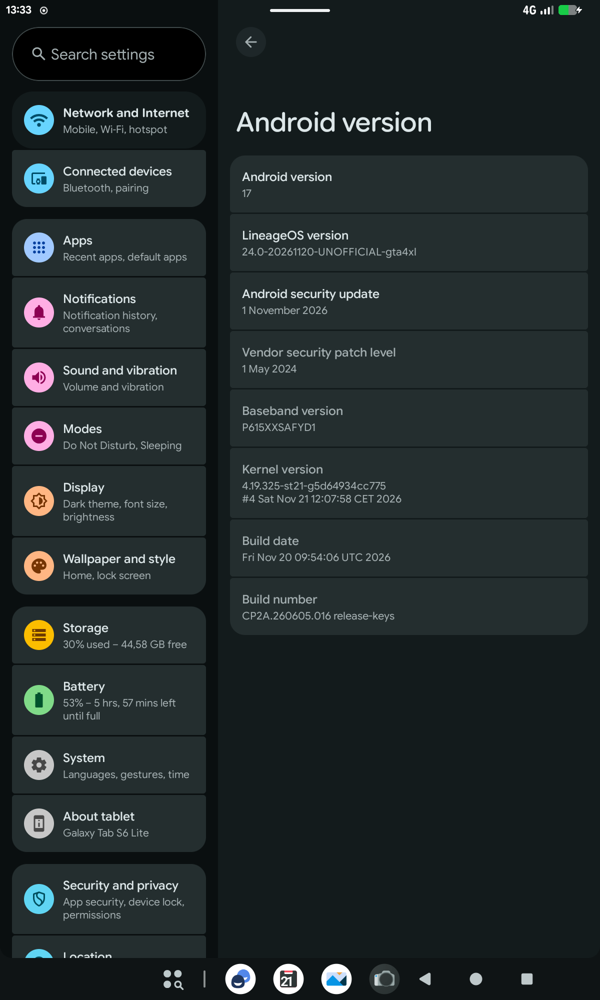

# LineageOS 24.0 for the Samsung Galaxy Tab S6 Lite LTE (gta4xl) — unofficial

Unofficial builds of **LineageOS 24.0 (Android 17)** for the **Samsung Galaxy Tab S6 Lite (2020), LTE model** (`gta4xl`, SM-P615, Exynos 9611).
This project is not affiliated with LineageOS or Samsung.

LineageOS supports this tablet officially up to 23.2 (Android 16), and its device trees, kernel and proprietary files have no `lineage-24.0` branch.
This repository builds LineageOS 24.0 from the 23.2 device trees: it carries the changes Android 17 needs as patch files (`patches/lineage-24.0/`), applied at build time, and replaces the tablet's 4.14 kernel with a [fork](https://github.com/6Xkljk8Vj7Tk1k4/android_kernel_samsung_gta4xl) on Linux 4.19 that has the kernel features Android 17 requires and gets security fixes again (see [The kernel](#the-kernel)).
Everything runs in a Podman container, so the host only needs Podman, Git and disk space.

How it started: my Tab S6 Lite ran LineageOS 23.2, and I did not want to wait for an official LineageOS 24.0.
With the help of [Claude](https://claude.ai) (Anthropic's AI assistant, used through Claude Code) it got Android 17.
Claude did most of the work — porting the device tree, finding out why each test boot failed, moving the tablet's drivers to a newer kernel, reviewing the kernel's security, writing the tests and this documentation — while I tested on the tablet.

<p align="center">
  
</p>

## Status

Tested on one SM-P615 with Samsung's firmware P615XXSAFYD1, used every day, and with an automated test of every component over adb (`tools/tablet-test.sh`, see [Tools](#tools)).
The table says what that test and daily use show.

| Feature | Status |
| --- | --- |
| Boot, display, touch, setup wizard | Works (about 26 s from power-on to the lock screen) |
| Wi-Fi | Works (tested on a WPA2 network; networks on 2.4 and 5 GHz are found) |
| Bluetooth | Works (audio devices not tested) |
| Audio | Speakers and microphone work (the test plays a tone and records it); headphone jack not tested |
| Cameras | Rear and front: photos, and video with sound (Aperture app) |
| Video | Hardware decoding and encoding of H.264, HEVC, VP8, VP9, MPEG-4 and H.263 |
| Sensors | Work (23 sensors register; accelerometer, gyroscope and light sensor deliver) |
| S Pen | Works |
| Charging, battery | Work from a USB port and a charger; fast chargers (AFC, USB PD) not tested with this kernel |
| Sleep | The tablet suspends when the screen is off and no computer is connected, and wakes up by the power key, an alarm or Wi-Fi |
| Storage | File-based encryption; reads from internal storage at about 490 MB/s |
| SIM, mobile data | Registers on LTE and mobile data works (one SIM tested); calls and SMS not tested |
| GPS | The receiver starts and receives satellites; a position fix has not been tested |
| USB | adb, file transfer mode (MTP) and USB tethering work (a computer on the cable reaches the internet through the tablet, IPv4 and IPv6) |
| Wi-Fi hotspot | Starts and sets up forwarding. This Wi-Fi chip cannot be a client and an access point at once, so Android switches the Wi-Fi client off while the hotspot is on and on again afterwards. Tested from the tablet's side only (no second device was connected) |
| Updates | With an own update server, also unattended (see [Update server](#update-server-optional)) |
| SELinux | Enforcing |
| Not tested | headphone jack, microSD card, USB accessories, Bluetooth audio, calls and SMS, a device connected through the hotspot |

### Known limitations

- **Unofficial port.** The device trees are LineageOS's 23.2 trees with the patches in this repository. When LineageOS releases an official 24.0 build for the gta4xl, switch to it (that needs a data wipe, see [Installation](#installation)).
- **Samsung's proprietary files are from 2024.** The vendor partition carries Samsung's files from firmware P615XXS8FXE4, the newest LineageOS uses for this tablet (vendor security patch level 2024-05-01). The Android security update shown in Settings covers the LineageOS system; the kernel gets the fixes listed under [The kernel](#the-kernel); Samsung's closed-source parts are not updated.
- **No over-the-air updates from this project.** The Updater app finds nothing for these builds. To update, install a newer build the same way (sideload), or run your own update server (see [Update server](#update-server-optional)).
- **The LTE model only.** Do not install this on the Wi-Fi-only Tab S6 Lite (SM-P610, `gta4xlwifi`) or on the 2022 and 2024 Tab S6 Lite (SM-P613, SM-P619, SM-P620, SM-P625): they need different builds.
- **Seen once, cause unknown:** after an unlock a kernel thread of Samsung's TrustZone driver kept one processor core busy (the tablet stays warm and loses charge) until that core was taken offline and online again; a restart clears it too. `tools/tablet-test.sh` reports such a thread.

## Download

There are no regular releases.
[Releases](https://github.com/6Xkljk8Vj7Tk1k4/lineageos-24.0-gta4xl-builder/releases) has one **proof-of-concept build** for trying the port: the install zip, `recovery.img`, `recovery.tar.md5` (the same recovery packed for Odin) and `SHA256SUMS`.
It is signed with the public AOSP test keys, so the tablet would trust an app or update package that anyone signs with them (see [Signing with your own keys](#signing-with-your-own-keys)).
For a tablet you use every day, build your own and sign it with your own keys: [Building](#building) walks through it.

On Linux, `sha256sum -c --ignore-missing SHA256SUMS` checks the downloads.

## Requirements

- A Galaxy Tab S6 Lite **SM-P615** (LTE). The model number is under Settings → About tablet, and in Download mode.
- **Samsung's latest Android 13 firmware** for the SM-P615: P615XXS8FXE4 or newer (tested with P615XXSAFYD1).
  While the tablet still runs Samsung's system, Settings → Software update installs it; the bootloader version shows in Download mode or with `adb shell getprop ro.boot.bootloader`.
  Official LineageOS builds for this tablet carry the P615XXS8FXE4 firmware and install it over older firmware; these builds do not (see [Firmware](#firmware)), so update first.
- An **unlocked bootloader**: follow the "Pre-Install Instructions" in the [LineageOS wiki's installation guide for the gta4xl](https://wiki.lineageos.org/devices/gta4xl/install/). Unlocking erases all data.
- A tool that flashes in Samsung's Download mode: [samloader-rs](https://github.com/topjohnwu/samloader-rs/releases/latest) (what the LineageOS wiki uses; Linux, macOS, Windows), Odin (Windows) or Heimdall.
- `adb` on the computer, for example from Google's [SDK Platform-Tools](https://developer.android.com/tools/releases/platform-tools).

## Installation

The first installation **erases all data** on the tablet, including the internal storage.

1. **Download mode:** turn the tablet off, hold **Volume Down + Volume Up** and connect the USB cable to the computer. Press **Volume Up** to continue.
2. **Flash the recovery** with one of the tools:
   ```bash
   samloader flash --partition RECOVERY recovery.img --no-reboot
   ```
   With Odin, put `recovery.tar.md5` into the **AP** slot, turn off **Auto Reboot** under Options and press Start.
   With Heimdall: `heimdall flash --RECOVERY recovery.img --no-reboot`.
   The tablet keeps showing "Downloading... Do not turn off target" when the flash is done.
3. **Boot straight into the recovery:** hold **Volume Down + Power** for about 8–10 seconds until the screen turns black, release the buttons immediately, then hold **Volume Up + Power** with the USB cable still connected, until the recovery appears.
   If Samsung's system starts instead, it replaces the new recovery with its own, and you have to flash it again.
4. In the recovery choose **Factory reset → Format data/factory reset** and confirm. This is needed for the first installation (and whenever you come from a build signed with other keys, the official LineageOS builds included).
5. Go back, choose **Apply update → Apply from ADB**, then on the computer:
   ```bash
   adb sideload lineage-24.0-YYYYMMDD-UNOFFICIAL-gta4xl.zip
   ```
   The percentage on the computer may stop at about 47 %, which is normal.
6. Go back and choose **Reboot system now**. The first boot takes a few minutes.

To update to a newer build signed with the same keys later, keep the data: reboot to the recovery (`adb reboot recovery`, or Volume Up + Power during the start), then **Apply update → Apply from ADB** and sideload the new zip.
The zip does not replace the recovery; the one from the first installation keeps working for updates.

A build signed with other keys always needs **Format data**. Its zip does not pass the signature check of a recovery from other keys: either flash that build's own `recovery.img` first (steps 1–3), or answer the recovery's "Signature verification failed" question with **Install anyway**.

### Firmware

Official LineageOS zips for this tablet contain Samsung's bootloader and modem firmware P615XXS8FXE4 (from TheMuppets' `radio/` folder) and write it during the installation when the tablet has an older version; on newer firmware they skip it, because the bootloader cannot be downgraded.
These builds leave that firmware out, as the maintainer's own builds always have: Samsung kept releasing newer Android 13 firmware for the SM-P615 (P615XXS9FXJ1, P615XXSAFYD1, P615XXUAFZB1), tablets that are up to date skip the bundled firmware anyway, and a build that never writes the bootloader cannot brick it.
The downside is that the update has to happen before the installation, while the tablet still runs Samsung's system (or from an official LineageOS build, which already installed P615XXS8FXE4).
To update the firmware of a tablet that already runs LineageOS, see the [LineageOS wiki's firmware guide](https://wiki.lineageos.org/devices/gta4xl/fw_update/).

## The kernel

Samsung never released a kernel newer than Linux 4.14 for this tablet's processor (Exynos 9611), and the 4.14 stable series ended in March 2026.
The build uses the fork **[6Xkljk8Vj7Tk1k4/android_kernel_samsung_gta4xl](https://github.com/6Xkljk8Vj7Tk1k4/android_kernel_samsung_gta4xl)**, branch `gta4xl-4.19`: **Linux 4.19.325**, made by adding this tablet to Samsung's 4.19 tree for the Exynos 850 as LineageOS maintains it for Android 17, and merged with the 4.19 stable backports of the [Civil Infrastructure Platform](https://www.cip-project.org/) (CIP), which continues the series after kernel.org ended it.
Its [README](https://github.com/6Xkljk8Vj7Tk1k4/android_kernel_samsung_gta4xl/blob/gta4xl-4.19/README.md) has the details: which drivers come from the tablet's 4.14 kernel and which from the 4.19 tree, what was measured, and what is still open.
`build.sh` swaps the fork in with a local manifest, sets `ro.bpf.kver_override=5.10.239` as the other LineageOS 24.0 devices on 4.14 and 4.19 kernels do (the kernel has the eBPF features Android 17 expects at the 5.10 level), and builds the video HAL with the kernel's own control ids.

What the fork does beyond running the tablet:

- **Upstream fixes again**: CIP's branch is merged once a month (5036 backports at the first merge), which covers the generic kernel as far as CIP backports it.
- **Security fixes that no 4.19 branch has**: fixes for Samsung's drivers and Android's additions, and upstream fixes that were never backported, among them CVE-2024-4610 and CVE-2023-26083 (Mali GPU driver, both exploited in the wild), CVE-2025-38352 (posix CPU timers, used against Android), and remote ones in IPv4, IPv6, TCP and cfg80211.
- **Bugs without a CVE**, found by reading the vendor code that an app or a Wi-Fi access point can reach: in Samsung's ION memory allocator and in the SCSC Wi-Fi driver, among them an out-of-bounds write that an access point could trigger with its association response, before any keys are exchanged.
- **Hardened configuration**: SLAB freelist randomisation and hardening, `BUG_ON_DATA_CORRUPTION`, `PANIC_ON_OOPS`, restricted `dmesg`, SYN cookies, zero-initialised stack variables, and the drivers and protocols this tablet does not have removed. `tools/tablet-test.sh` compares the configuration with what Android asks for and knows the reason for every option that is left out.
- **Monthly review** of every new kernel CVE against the files this configuration actually compiles: `tools/kernel-cve-check.sh`, with every decision recorded in `tools/kernel-cve-triage.tsv` and `tools/kernel-cve-triage-4.19.tsv`.
- **Speed**: the kernel runs under Samsung's hypervisor, which makes some operations unusually expensive on this board; with a few changes for that, system calls take a third less time than on the 4.14 kernel and apps start about 7 % faster.

Still open in the Mali GPU driver: CVE-2024-0671 and CVE-2025-0427, whose fixes exist only in driver releases newer than any public source.
The fork's previous kernel, 4.14 with the same Android 17 backports (branch `gta4xl-24.0`), is archived; `-e KERNEL_REVISION=gta4xl-24.0` still builds it.

## Building

### What you need

- A computer with **Linux** (these steps use Ubuntu or Fedora). Windows with WSL2 may work but is untested.
- About **350 GB of free disk space**: the sources take about 190 GB, the build about 135 GB, the compiler cache up to 30 GB.
- **32 GB of RAM**, or less RAM plus a large swap file (see step 2). Less memory only makes the build slower.
- A fast internet connection: the first download is several tens of gigabytes.
- Time: the first download takes a few hours, the first build several more (about 4.5 hours on an 8-core desktop with 32 GB). Later builds take 20–60 minutes.

### Step by step

**1. Install Podman and Git.**
Ubuntu or Debian:
```bash
sudo apt update && sudo apt install -y podman git
```
Fedora:
```bash
sudo dnf install -y podman git
```

**2. Check the free space and the memory.**
```bash
df -h ~          # the "Avail" column needs about 350G
free -g          # RAM ("Mem") plus swap ("Swap") should add up to 64 or more
```
If RAM plus swap is below 64 GB, add a swap file (here 48 GB; it is removed again with `sudo swapoff /swapfile && sudo rm /swapfile`):
```bash
sudo fallocate -l 48G /swapfile && sudo chmod 600 /swapfile
sudo mkswap /swapfile && sudo swapon /swapfile
```
On btrfs (Fedora's default) `swapon` refuses a file made like that; there, use `sudo btrfs filesystem mkswapfile --size 48g /swapfile && sudo swapon /swapfile` instead.

**3. Download this repository and build the container image** (a few minutes):
```bash
git clone https://github.com/6Xkljk8Vj7Tk1k4/lineageos-24.0-gta4xl-builder.git
cd lineageos-24.0-gta4xl-builder
podman build -t lineageos-gta4xl-builder .
```

**4. Download Samsung's proprietary files** (about 120 MB, from the [TheMuppets](https://github.com/TheMuppets) repositories official LineageOS builds use):
```bash
tools/fetch-blobs.sh
```

**5. Create the folders for the sources and the compiler cache.**
The build runs as a user with id 1000 inside the container; this gives it the folders:
```bash
mkdir -p src ccache
podman unshare chown 1000:1000 src ccache
```

**6. Start the build.**
`-d` runs it in the background, so you can close the terminal or log out.
`--security-opt label=disable` lets the container use the folders on systems with SELinux, such as Fedora; elsewhere it has no effect.
```bash
podman run -d --rm --security-opt label=disable \
    -v "$(pwd)":/home/builder/repo:ro \
    -v "$(pwd)/src":/home/builder/android/lineage \
    -v "$(pwd)/ccache":/home/builder/ccache \
    --name gta4xl-build lineageos-gta4xl-builder
```

**7. Watch the progress** (`Ctrl+C` stops only the watching, not the build):
```bash
podman logs -f gta4xl-build
```
First the sources download (`>>> repo sync`), then the proprietary files and patches are added (`>>> Patches: ...`), then the build runs (`>>> mka bacon`).
For half an hour or more after that nothing seems to happen: the build system is analysing the sources.
Then lines like `[ 42% 98000/234000] ...` show the progress.
`podman ps` shows whether the build is still running.

**8. Get the result.**
When the log ends with `>>> Build finished`, the files to install are in `src/out/target/product/gta4xl/`:
`lineage-24.0-YYYYMMDD-UNOFFICIAL-gta4xl.zip` and `recovery.img` (the log shows their checksums).
Install them as described in [Installation](#installation); for Odin, pack the recovery with `tar -H ustar -cf recovery.tar recovery.img`.

### Signing with your own keys

Without this step the build is signed with the public AOSP test keys, like most unofficial builds.
Anyone can sign an app or an update package with those keys and the tablet trusts it; an app signed with the public platform key even gets system privileges.
For a tablet you use every day, sign the build with your own keys:

1. **Download the sources once without building:** run step 6 with `-e SYNC_ONLY=true` added (for example on its own line before `--name`) and wait until the log ends with `>>> SYNC_ONLY=true - sources synced`.
   The key tool needs the synced sources to know which keys LineageOS uses.
2. **Create the keys:**
   ```bash
   tools/make-keys.sh
   ```
   It asks for a password twice (and once more to check the result), and writes `signing/keys/` (the keys in plain form) and `signing/signing-keys.enc` (the same keys, encrypted with the password).
   Copy `signing/keys/` somewhere safe and offline, for example to an encrypted USB stick, then delete it from this computer: the build only needs `signing-keys.enc`.
3. **Build with the keys:** in step 6, use `-it` instead of `-d` and add this line before `--name`:
   ```bash
       -v "$(pwd)/signing/signing-keys.enc":/home/builder/signing-keys.enc:ro \
   ```
   The build asks for the password right at the start.
   Then press `Ctrl+P` followed by `Ctrl+Q` to detach from the build; it keeps running, and `podman logs -f gta4xl-build` shows it again.
   The decrypted keys exist only inside the source folder while the build runs and are deleted when it ends.
4. Install the result as described in [Installation](#installation), with your build's `recovery.img` and **with Format data**: the first build signed with your own keys cannot be installed over a build signed with other keys, the proof-of-concept build included.

Every later build must be signed with the same keys; otherwise it can only be installed after wiping the data.
Anyone who has the keys can sign packages your tablet trusts, so never share or upload them, and keep the password safe: without it `signing-keys.enc` is useless.
After a LineageOS update the build may report APEX modules without a key (`>>> WARNING: no key for these APEXes`): put the plain keys back into `signing/keys/` and run `tools/make-keys.sh -u`, which adds the missing ones and encrypts the set again.
Moving an existing installation to new keys without wiping it is possible with the key migration script described in the LineageOS wiki's [Signing Builds](https://wiki.lineageos.org/signing_builds).

### When something goes wrong

- **The build stopped** (power cut, `podman stop gta4xl-build`, an error): run the command from step 6 again. Finished work is kept.
- **"Free space below ... GB - aborting the build"**: the disk is nearly full and the build stopped itself. Free some space and run step 6 again.
- **"The container cannot read these files from the host"** or **"Permission denied"** when the container starts: make the repository folder readable with `chmod -R o+rX .` in it. On Fedora and other systems with SELinux, check that the command has `--security-opt label=disable`.
- **"No proprietary files"**: run `tools/fetch-blobs.sh` (step 4).
- **A patch does not apply** (`!!! The patches for ... no longer apply`): LineageOS changed the code a patch touches. Open an issue with the end of the newest file in `src/logs/`.
- **An error early in the build, before the progress counter starts** (`found in multiple namespaces`, `missing dependency`): LineageOS changed something that needs a matching change in the proprietary files. Run `tools/fetch-blobs.sh` again — TheMuppets usually has the fix — and restart the build; if that does not help, open an issue.
- **Another build error** (`FAILED:` in the log): open an issue with the end of the newest file in `src/logs/`.

### Updating and cleaning up

- To build a newer version: `git pull`, then step 6. Only the changes are downloaded and rebuilt. LineageOS publishes Android's security fixes monthly, so a monthly build keeps the system up to date.
- To remove everything again: `podman unshare rm -rf src ccache` (normal `rm` cannot delete files created by the container).

### Options

Options are passed to step 6 with `-e NAME=value`. An empty value (for example `-e NTP_SERVER=`) turns a tweak off and keeps LineageOS's behaviour.

| Option | Default | Meaning |
| --- | --- | --- |
| `SYNC_ONLY` | `false` | `true`: only download the sources, do not build |
| `SKIP_SYNC` | `false` | `true`: build the sources as they are, without downloading changes |
| `KEEP_GOING` | `false` | `true`: collect all build errors in one run instead of stopping at the first |
| `BUILD_JOBS` / `SYNC_JOBS` | number of CPU threads / `4` | Parallel build and download jobs; fewer build jobs need less memory |
| `CCACHE_SIZE` | `30G` | Size limit of the compiler cache |
| `MIN_FREE_GB` | `15` | The build stops when the disk has less free space than this |
| `KERNEL_REPO_URL` / `KERNEL_REVISION` | the fork / `gta4xl-4.19` | Kernel repository and branch; `gta4xl-24.0` is the fork's archived 4.14 kernel; empty `KERNEL_REPO_URL` = LineageOS's 23.2 kernel, which does not boot Android 17 |
| `FALLBACK_DNS` | `1.1.1.1 1.0.0.1` | DNS servers used only when the Wi-Fi network's DHCP hands out none (Android's own fallback is Google's) |
| `NTP_SERVER` | `pool.ntp.org` | Time server instead of Google's `time.android.com` |
| `DEBLOAT_PACKAGES` | `Recorder Twelve Seedvault Backgrounds LiveWallpapersPicker PhotoTable BasicDreams Profiles` | Apps left out of the image: recorder, music player, backup app, wallpapers, screen savers and LineageOS's profiles. Empty = keep them all |
| `TRUST_VENDOR_PATCH_FINAL` | `true` | LineageOS's Trust page rates the vendor security patch level of Samsung's files (2024-05-01, the newest LineageOS uses for this tablet) as current instead of showing a permanent warning; Settings still shows the real date |
| `DEVELOPER_OPTIONS_VISIBLE` | `true` | Developer options visible without tapping the build number seven times |
| `ADVANCED_RESTART` | `true` | Recovery and bootloader in the power menu's restart options |
| `WINDOW_BLUR` | `false` | Background blur behind the app drawer and the notification shade. Off because this GPU cannot keep up with it at the screen's resolution (the animation's median frame takes 37 ms with blur, 14 ms without); `true` keeps LineageOS's setting |
| `PRIVATE_DNS_HOST` | empty | A DNS-over-TLS server as the default Private DNS (strict mode); off by default because networks that block port 853 would have no DNS |
| `OTA_BASE_URL` | empty | Your update server, see below |
| `OTA_AUTO_INSTALL` | `false` | `true` (with `OTA_BASE_URL`): the tablet downloads and installs updates from your server by itself, see below |
| `CAPTIVE_PORTAL_HOST` | empty | A host for Android's connectivity check instead of Google's, see below |
| `WITH_ADB_INSECURE` | empty | `true`: adb without authorization from the first boot (LineageOS's switch). Only for test builds, never for builds you give to others |

[CLAUDE.md](CLAUDE.md) documents the build system, every patch and the porting and kernel notes in detail.

## Update server (optional)

With `-e OTA_BASE_URL=https://ota.example.org`, the build points LineageOS's Updater app at your own server and writes the update metadata (`src/out/target/product/gta4xl/ota/gta4xl.json`) next to a copy of the zip.
`OTA_REMOTE=user@host:/srv/ota tools/ota-upload.sh` uploads both over SSH into the layout the Updater expects (`<OTA_BASE_URL>/api/v1/gta4xl/<type>/` for the metadata, `<OTA_BASE_URL>/gta4xl/` for the zip).
`ota/Caddyfile` and `ota/ota.container` are an example server (a Caddy container for rootless Podman) to put behind a reverse proxy that handles TLS for your domain; the Updater only accepts https.

With `-e OTA_AUTO_INSTALL=true` in addition, the tablet updates itself (`patches/lineage-24.0/packages/apps/Updater`): the Updater checks for a new build when the tablet starts, downloads it on an unmetered network and installs it while the screen is off and the tablet is idle, on the charger or between midnight and 5 a.m.
It only takes the newest build of the same Android version, checks the package's signed metadata before it starts, and tries each package once; a failed download is tried again later.
Without the option the Updater works as in LineageOS: it shows the update and waits for you.

With `-e CAPTIVE_PORTAL_HOST=ota.example.org`, Android's connectivity check asks that host instead of Google's servers.
The host must answer `/generate_204` with a bare `204 No Content` over both http and https, without redirecting http to https; the example Caddyfile does that, the proxy in front must let it through.
The build checks the host first and keeps Google's check if it does not answer correctly, because otherwise every Wi-Fi network would look like it has no internet.

## Tools

All run on the computer; the tablet ones over adb.

- `tools/tablet-test.sh`: tests the installed build component by component and records the log lines, SELinux denials and crashes each test caused, in `build_output/tablet-test/`. It follows three lists: LineageOS's [device support requirements](https://github.com/LineageOS/charter/blob/main/device-support-requirements.md) (what has to work, and equal Samsung's system, on a device LineageOS supports), Android's vendor test suite (the kernel's interfaces; `vintf` on the tablet: manifests, compatibility matrices, kernel configuration, every declared HAL registered), and what went wrong on this tablet during the port. Among its 30 parts: boot time and how the last start ended, storage wear, CPU cores going offline and online, battery wear and charging current, display, touch and S Pen controllers, events from each sensor, Wi-Fi and Bluetooth with their factory addresses, registration and mobile data with a SIM, the GNSS receiver, speaker and microphone (it plays a tone and records it), keys in the TEE, every hardware video encoder and decoder, both cameras (it decodes the photos and the clip and measures the clip's sound), every preinstalled app, the security settings, and one suspend/resume cycle of all drivers. Optional parts switch the USB port to file transfer and tethering (`USB=1`), start the Wi-Fi hotspot (`HOTSPOT=1`) and restart the tablet (`REBOOT=1`). It needs Developer options → Rooted debugging; it changes radio settings, location and the media volume during the test and puts them back. For the checks that look into pictures and clips the computer needs `python3` with Pillow and numpy, and `ffmpeg`.
- `tools/tablet-setup.sh`: after an installation, installs every APK from a folder and connects to Wi-Fi.
- `tools/kernel-build.sh` and `tools/kernel-flash.sh`: build the kernel fork on its own in a few minutes and test it on the tablet without building the whole system (with a backup and a restore path). `tools/kernel-romtc-build.sh` builds it with the compiler and tools of the synced Android tree, exactly as the ROM build will.
- `tools/kernel-cve-check.sh`: the monthly kernel CVE review described under [The kernel](#the-kernel); `tools/kernel_cve_dossier.py` prepares the CVEs it lists for reading (the CNA's text, the oldest stable fix, the matching code of this kernel).

## Credits

- The [LineageOS](https://lineageos.org) project.
- The authors of the gta4xl device trees and kernel, above all Tim Zimmermann (Linux4) and Kevin F. Haggerty (haggertk), and LuK1337, Bruno Martins, Andreas Schneider, Michael Bestas and many others.
- [TheMuppets](https://github.com/TheMuppets) for the proprietary files.
- The LineageOS maintainers of the Exynos 850 kernel (`android_kernel_samsung_exynos850`), the tree the kernel fork is built on, and of the Galaxy A21s, whose 24.0 device-tree changes showed the way for several patches here.
- The [Civil Infrastructure Platform](https://www.cip-project.org/) for keeping Linux 4.19 maintained, and the kernel CNA for the CVE data.
- [PhoenixKernel](https://github.com/PhoenixKernel), the maintainers of LineageOS 24.0 for Motorola's Exynos 9610 phones and the OpenELA project, whose work the fork's 4.14 kernel was built on.

## License

The scripts and the documentation are under the Apache License 2.0 ([LICENSE](LICENSE)).
The patches change LineageOS projects and are under the licenses of those projects.

## Disclaimer

This is an unofficial build that comes without any warranty.
Flashing it erases your data, and flashing in Download mode incorrectly can make the tablet unbootable.
